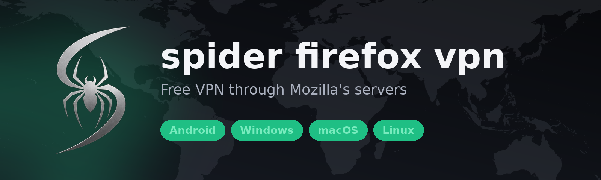

  

  
  
  

  <b>فارسی</b> · <a href="#english">English</a>

# 🕷️ spider firefox vpn

یک **VPN رایگان** برای **اندروید، ویندوز، مک و لینوکس**. با حساب Firefox خودتان وارد می‌شوید و ترافیکتان از طریق سرورهای Mozilla عبور می‌کند.

> ⚠️ این برنامه **غیررسمی** است و ربطی به Mozilla ندارد.

---

## ✨ امکانات

| | |
|---|---|
| 🖥️ **چهار سیستم‌عامل** | اندروید (و Android TV)، ویندوز، مک، لینوکس |
| 🆓 **رایگان و بدون تبلیغ** | تا ۵۰ گیگابایت در ماه برای هر حساب Firefox |
| 🔁 **چند حساب** | وقتی حجم یک حساب تمام شود، حساب بعدی خودکار وصل می‌شود |
| 🌍 **انتخاب کشور** | پرچم‌ها را بزنید، یا بگذارید سریع‌ترین سرور خودکار انتخاب شود |
| 📊 **آمار زنده** | سرعت دانلود و آپلود، تأخیر، مدت اتصال و **حجم مصرف شده از ۵۰ گیگ** |
| 🌗 **تم تیره و روشن** | با لوگوی اسپایدر و طراحی ساده |
| 📜 **تب لاگ** | برای پیدا کردن مشکل اتصال |
| 🛡️ **سرور رله** | اگر Mozilla روی شبکهٔ شما بسته است، با Cloudflare Worker خودتان وصل شوید |

---

## ⬇️ دانلود

آخرین نسخه از بخش **[Releases](https://github.com/ppj30088-hash/firefox-spider-vpn/releases/latest)**:

| سیستم | فایل | توضیح |
|---|---|---|
| 🤖 اندروید | [**arm64-v8a**](https://github.com/ppj30088-hash/firefox-spider-vpn/releases/latest/download/Spider-Firefox-VPN-Android-arm64-v8a.apk) | اکثر گوشی‌های امروزی (۶۴ بیتی). حدود ۴۰ مگ |
| 🤖 اندروید | [armeabi-v7a](https://github.com/ppj30088-hash/firefox-spider-vpn/releases/latest/download/Spider-Firefox-VPN-Android-armeabi-v7a.apk) | گوشی‌های قدیمی (۳۲ بیتی) |
| 🤖 اندروید / TV | [universal](https://github.com/ppj30088-hash/firefox-spider-vpn/releases/latest/download/Spider-Firefox-VPN-Android-universal.apk) | هر دستگاهی، حجم بیشتر |
| 🪟 ویندوز (۶۴ بیتی) | [نصب‌کننده](https://github.com/ppj30088-hash/firefox-spider-vpn/releases/latest/download/Spider-Firefox-VPN-Windows-Setup-x64.exe) · [نسخهٔ قابل‌حمل](https://github.com/ppj30088-hash/firefox-spider-vpn/releases/latest/download/Spider-Firefox-VPN-Windows-x64.zip) | |
| 🍎 مک | [dmg](https://github.com/ppj30088-hash/firefox-spider-vpn/releases/latest/download/Spider-Firefox-VPN-macOS.dmg) | |
| 🐧 لینوکس | [x64](https://github.com/ppj30088-hash/firefox-spider-vpn/releases/latest/download/Spider-Firefox-VPN-Linux-amd64.tar.gz) · [arm64](https://github.com/ppj30088-hash/firefox-spider-vpn/releases/latest/download/Spider-Firefox-VPN-Linux-arm64.tar.gz) | |

---

## 🚀 نصب و استفاده

**اندروید**
1. فایل را دانلود و باز کنید. اگر خواست، اجازهٔ «نصب از منبع ناشناس» را بدهید.
2. اگر Play Protect هشدار داد: **More details** ← **Install anyway**.

**ویندوز:** نصب‌کننده را اجرا کنید. اگر SmartScreen هشدار داد: **More info** ← **Run anyway**.

**مک:** dmg را باز کنید و برنامه را به Applications بکشید. اگر مک جلویش را گرفت: راست‌کلیک ← **Open**.

**لینوکس:** `tar -xzf` فایل را باز کنید و برنامه را اجرا کنید.

**بعد از نصب**
1. برنامه را باز کنید و در **Accounts** یک حساب Firefox اضافه کنید (ایمیل، رمز، و کد تأیید در صورت درخواست).
2. روی **دایرهٔ اسپایدر** بزنید تا وصل شود.
3. برای عوض کردن کشور، روی پرچم‌ها یا کارت مکان بزنید.
4. حجم مصرف شده از ۵۰ گیگ را در صفحهٔ اصلی ببینید.

---

## ❓ سؤالات رایج

<b>«The account was not added» با خطای <code>Fastly anti-bot challenge … HTTP 406</code></b>

سایت ورود Mozilla پشت محافظ ضد‌ربات Fastly است. این‌ها را امتحان کنید:
1. هر VPN یا پراکسی دیگر را **خاموش** کنید.
2. شبکه را عوض کنید (وای‌فای ↔ دیتا).
3. چند ساعت صبر کنید و فقط **یک بار** دوباره امتحان کنید.
4. اگر Mozilla روی شبکهٔ شما بسته است، در **Settings ← Connection ← Relay server** آدرس یک Cloudflare Worker شخصی بگذارید. کد آماده در `core/scripts/relay/worker.js` است. این روش تضمینی نیست.

<b>کدام فایل اندروید را بگیرم؟</b>

اگر مطمئن نیستید، **arm64-v8a**. فقط اگر نصب نشد یا گوشی خیلی قدیمی است، **armeabi-v7a** یا **universal**.

<b>هنگام نصب اندروید هشدار ویروس می‌دهد</b>

چون برنامه از Play Store نیست، گوگل برای هر برنامهٔ ناشناخته هشدار می‌دهد. **More details ← Install anyway** را بزنید.

<b>نسخهٔ ۳۲ بیتی ویندوز دارد؟</b>

نه. فقط ویندوز ۶۴ بیتی پشتیبانی می‌شود.

---

## 🛠️ ساخت و انتشار

با هر push روی شاخهٔ `main`، اگر نسخهٔ `app/pubspec.yaml` هنوز Release نداشته باشد، GitHub Actions برنامه را برای هر چهار سیستم می‌سازد و خودکار در Releases منتشر می‌کند. برای انتشار دستی: **Actions ← Build ← Run workflow**.

---

# 🕷️ spider firefox vpn

A **free VPN** for **Android, Windows, macOS and Linux**. Sign in with your own Firefox Account and your traffic goes through Mozilla's servers.

> ⚠️ This app is **unofficial** and not affiliated with Mozilla.

## ✨ Features

| | |
|---|---|
| 🖥️ **Four systems** | Android (and Android TV), Windows, macOS, Linux |
| 🆓 **Free, no ads** | Up to 50 GB a month for every Firefox Account |
| 🔁 **Multi-account** | When one account's data runs out, the next takes over |
| 🌍 **Pick a country** | Tap a flag, or let the app choose the fastest server |
| 📊 **Live stats** | Download and upload speed, delay, connection time, and **data used of 50 GB** |
| 🌗 **Dark and light** | Spider logo, clean design |
| 📜 **Logs tab** | To find out why a connection fails |
| 🛡️ **Relay server** | If Mozilla is blocked on your network, connect through your own Cloudflare Worker |

## ⬇️ Download

Get the latest build from **[Releases](https://github.com/ppj30088-hash/firefox-spider-vpn/releases/latest)**:

| System | File | Note |
|---|---|---|
| 🤖 Android | [**arm64-v8a**](https://github.com/ppj30088-hash/firefox-spider-vpn/releases/latest/download/Spider-Firefox-VPN-Android-arm64-v8a.apk) | Most phones today (64-bit), ~40 MB |
| 🤖 Android | [armeabi-v7a](https://github.com/ppj30088-hash/firefox-spider-vpn/releases/latest/download/Spider-Firefox-VPN-Android-armeabi-v7a.apk) | Older phones (32-bit) |
| 🤖 Android / TV | [universal](https://github.com/ppj30088-hash/firefox-spider-vpn/releases/latest/download/Spider-Firefox-VPN-Android-universal.apk) | Any device, larger file |
| 🪟 Windows (64-bit) | [Setup](https://github.com/ppj30088-hash/firefox-spider-vpn/releases/latest/download/Spider-Firefox-VPN-Windows-Setup-x64.exe) · [portable zip](https://github.com/ppj30088-hash/firefox-spider-vpn/releases/latest/download/Spider-Firefox-VPN-Windows-x64.zip) | |
| 🍎 macOS | [dmg](https://github.com/ppj30088-hash/firefox-spider-vpn/releases/latest/download/Spider-Firefox-VPN-macOS.dmg) | |
| 🐧 Linux | [x64](https://github.com/ppj30088-hash/firefox-spider-vpn/releases/latest/download/Spider-Firefox-VPN-Linux-amd64.tar.gz) · [arm64](https://github.com/ppj30088-hash/firefox-spider-vpn/releases/latest/download/Spider-Firefox-VPN-Linux-arm64.tar.gz) | |

## 🚀 Install and use

- **Android:** open the file and allow installs from this source. If Play Protect warns: **More details** → **Install anyway**.
- **Windows:** run the setup. If SmartScreen warns: **More info** → **Run anyway**.
- **macOS:** open the dmg and drag the app to Applications. If macOS blocks it: right-click → **Open**.
- **Linux:** extract with `tar -xzf` and run the app.

Then: add a Firefox account in **Accounts**, tap the **spider button** to connect, tap a flag to change country, and watch your data used of 50 GB on the home screen.

## ❓ FAQ

<b>"The account was not added": <code>Fastly anti-bot challenge … HTTP 406</code></b>

Mozilla's sign-in is behind Fastly's anti-bot check. Try: turn off any other VPN or proxy; switch network (Wi-Fi ↔ mobile data); wait a few hours and try **once**. If Mozilla is blocked where you are, set a personal Cloudflare Worker in **Settings → Connection → Relay server** (ready code: `core/scripts/relay/worker.js`). Not guaranteed to work.

<b>Which Android file do I need?</b>

If unsure, **arm64-v8a**. Only if it will not install, or the phone is very old, take **armeabi-v7a** or **universal**.

<b>Windows 32-bit?</b>

Not supported; 64-bit Windows only.

## 🛠️ Build and release

On every push to `main`, if the version in `app/pubspec.yaml` has no release yet, GitHub Actions builds all four systems and publishes the release by itself. To publish by hand: **Actions → Build → Run workflow**.

---

Based on <a href="https://github.com/armanlife/arman-vpn-client">armanlife/arman-vpn-client</a>

این پروژه از https://github.com/armanlife/arman-vpn-client فورک شده
